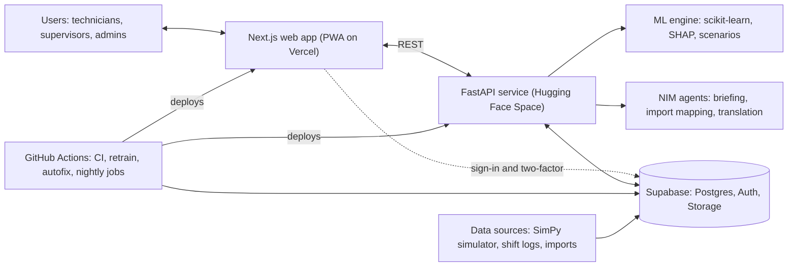
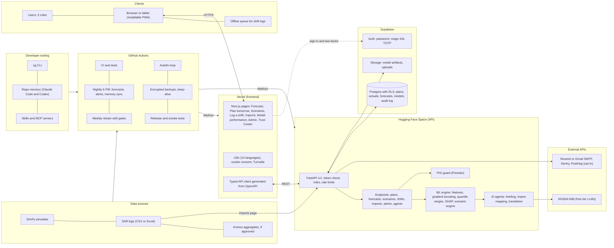

# SterileGuard AI Technical Plan
 
Oct 11, 2026 · Jay Patel, Leocalis Quezada & Carlos
 
Version 1.0 (final), CPE 595 Applied Machine Learning, Group 8. Live version: https://claude.ai/code/artifact/d5592584-341a-45de-9ad2-dc6d0ff989dd. Implementation tickets SG-00 to SG-36 are in ClickUp (SterileGuard workspace).
 
## 1. Overview
 
SterileGuard AI is a multi-tenant web platform that forecasts next-day overtime for sterile processing departments and recommends staffing changes before the shift starts. This plan treats it as production software for a large health system, built entirely on free tiers.
 
**Guiding principles**
 
- Decision support only. The app never makes staffing decisions on its own.
- No patient data anywhere. Equipment, schedule, staffing, and workload data only.
- HIPAA-style safeguards throughout, with no claim of HIPAA compliance.
- Every number is traceable to a model version, a data source, and real vs simulated origin.
- Accessible (WCAG 2.2 AA), multilingual, and usable on tablets on the work floor.
- Zero budget. Every service runs on a free tier.
- Agent-friendly repo. Claude Code or Codex can pick up any task from the repo memory alone.
| Constraint | How the plan handles it |
| --- | --- |
| Free tiers only | Keep-alive jobs for services that sleep, caching and batching for the rate-limited LLM API |
| No patient data | No patient fields in the schema, plus a PHI guard on every free-text field and import |
| Unknown real data format | Data Import Agent with reusable mapping templates (Section 10) |
| Three developers, eight weeks | Phased roadmap where every phase ends in something demoable, heavy automation |
 
## 2. Product Scope
 
### 2.1 Tenancy model
 
Organization (health system) → Facility (hospital or dental school) → Department (for example Dental Central Sterile) → Members with roles. The demo seeds one organization, one facility, and one department.
 
### 2.2 Roles and permissions
 
| Capability | Technician | Supervisor | Dept Admin | Data Steward | Platform Admin |
| --- | --- | --- | --- | --- | --- |
| View next-day forecast and drivers | Yes | Yes | Yes | Yes | Yes |
| Plan tomorrow (enter known inputs) |  | Yes | Yes |  |  |
| Log shift actuals | Yes | Yes | Yes |  |  |
| Approve shift logs |  | Yes | Yes |  |  |
| Run staffing scenarios |  | Yes | Yes |  |  |
| Import and clean data |  |  | Yes | Yes |  |
| Manage users, invites, roles |  |  | Yes |  | Yes |
| Department settings and thresholds |  |  | Yes |  |  |
| View audit log |  |  | Yes |  | Yes |
| Model registry and activation |  |  |  |  | Yes |
| Manage organizations |  |  |  |  | Yes |
 
### 2.3 Core features
 
1. **Plan tomorrow.** Supervisors enter or import the next day's known inputs, pre-filled from department defaults.
2. **Next-day forecast.** Overtime labor-hours with an 80% range, a burden category, and its probability.
3. **Driver explanations.** SHAP-based, written in plain language.
4. **Staffing scenarios.** Edit staffing by time window and get the minimum change that brings risk under target.
5. **Shift briefing.** A short AI-written summary in the user's language.
6. **Shift logging.** Actual outcomes entered after the shift, with supervisor approval.
7. **Data import.** Upload messy CSV or Excel files and let the import agent clean and map them.
8. **Model performance.** Predicted vs actual, metrics by model version, drift indicators.
9. **Notifications.** In-app alerts and an evening email when tomorrow looks severe.
10. **Administration.** Users, invites, roles, shift windows, thresholds, audit log.
11. **Trust Center.** Every legal, privacy, security, and AI transparency page.
### 2.4 Sitemap
 
- **Public:** landing page, sign in, accept invite, Trust Center (`/trust/*`), status page
- **App (`/app`):** Forecast (home), Plan tomorrow, Scenarios, Log a shift, Shift history, Imports, Model performance, Notifications
- **Settings:** profile, language, theme, two-factor authentication, notification preferences
- **Admin:** users and invites, department settings, audit log, data retention
- **Platform:** organizations, model registry
## 3. Domain Reference
 
This is the sterile processing knowledge the simulation and features are built on. Leo should verify every number against the department's procedures and the manufacturers' instructions for use (IFUs), which legally control how equipment is operated.
 
### 3.1 Reprocessing workflow
 
1. **Point of use.** Clinicians pre-clean and contain used instruments in the clinic.
2. **Transport** to Central Sterile in closed, labeled containers.
3. **Receiving and decontamination.** Staff in PPE sort, disassemble, and soak items (OSHA Bloodborne Pathogens Standard applies).
4. **Cleaning** in ultrasonic cleaners and washer-disinfectors. The department has two washers.
5. **Inspection and assembly.** Check cleanliness and function, often under magnification. Handpieces are lubricated per IFU.
6. **Packaging.** Cassettes are wrapped, single instruments go in peel pouches, each with a chemical indicator.
7. **Sterilization** in steam sterilizers. The department has two.
8. **Cooling, drying, and storage.**
9. **Distribution** to clinics, student modules, and maxillofacial (MF) surgery.
10. **Returns.** Issued but unused instruments come back and re-enter the workflow.
### 3.2 Instrument categories and work units
 
The Spaulding classification drives handling. Critical items that penetrate tissue (surgical instruments, scalers, burs) must be heat sterilized. Semicritical items that touch mucous membranes (mirrors, handpieces) are heat sterilized when heat tolerant. Noncritical items get cleaning and disinfection.
 
| Work unit | Examples | Modeling notes |
| --- | --- | --- |
| Cassette | Exam, restorative, and periodontal kits | Most common unit from student clinics |
| Peel pouch | Single instruments, burs, endodontic files | High volume, short per-unit time |
| MF surgical tray | Maxillofacial sets | Larger, longer inspection and assembly |
| Handpiece | High and low speed | Cleaning, lubrication, and sterilization per IFU |
| Returned unused item | Any issued item not used | Re-enters decontamination |
 
### 3.3 Timing starting points for calibration
 
| Stage | Typical value | Verify against |
| --- | --- | --- |
| Washer-disinfector cycle | About 30 to 60 minutes | Washer IFU |
| Steam, dynamic air removal, wrapped | 132°C (270°F) for 4 minutes exposure, plus drying | CDC, AAMI ST79, sterilizer IFU |
| Steam, gravity displacement, wrapped | 121°C (250°F) for 30 minutes exposure, plus drying | CDC, sterilizer IFU |
| Pickup to sterile, full workflow | 2 to 2.5 hours | Leo's observations |
 
### 3.4 Quality monitoring
 
Every cycle is monitored mechanically (cycle printouts), every package carries a chemical indicator, and CDC recommends biological spore testing at least weekly in dental settings. A failed biological indicator triggers a recall and a reprocessing spike, which the simulation models as a rare event.
 
### 3.5 Governing standards
 
- CDC Guidelines for Infection Control in Dental Health-Care Settings (2003) and the Summary of Infection Prevention Practices in Dental Settings (2016)
- ANSI/AAMI ST79, comprehensive guide to steam sterilization in health care facilities
- OSHA Bloodborne Pathogens Standard, 29 CFR 1910.1030
- Manufacturer IFUs for every washer, sterilizer, and instrument
### 3.6 Workload drivers
 
- **Known before 7 AM (model inputs):** scheduled patients, MF cases, student clinic sessions, academic calendar (exams, breaks, semester start), staffing by time window, voluntary overtime availability, outside support, washer and sterilizer status, carryover backlog, day of week, holidays
- **Known after the shift (calibration and analysis):** returned unused instruments, emergency and intake volume, equipment downtime, biological indicator failures, end-of-day backlog
## 4. Architecture and Stack
 
The web app handles sign-in directly with Supabase Auth. Every business request (forecasts, scenarios, shift logs, imports, agents) goes through FastAPI, which verifies the user's token, checks the role, and queries Postgres with that user's token so row-level security still applies.
 

 
Heavy jobs such as simulation, retraining, and nightly forecasts run in GitHub Actions and write results back to Supabase, so the free API host never has to do long-running work.
 
| Layer | Choice | Why |
| --- | --- | --- |
| Web framework | Next.js (App Router), React, TypeScript strict | Server rendering, routing, strong ecosystem |
| UI | Tailwind CSS, shadcn/ui on Radix primitives, Motion, lucide icons | Accessible primitives with full design control |
| Charts | Recharts through shadcn chart components | Matches the design system |
| Client data and forms | TanStack Query, TanStack Table, react-hook-form with zod | Caching, large tables, typed validation |
| i18n | next-intl | ICU messages, RTL, locale routing |
| API | FastAPI, Pydantic v2, Uvicorn | Typed endpoints, automatic OpenAPI |
| API contract | openapi-typescript and openapi-fetch | Frontend types generated from the backend, no drift |
| Database, auth, files | Supabase (Postgres, Auth, Storage) | Row-level security and auth included |
| ML | scikit-learn, SHAP, Optuna, pandas, NumPy | Course-aligned, free, explainable |
| Simulation | SimPy | Discrete-event modeling |
| Data validation | pandera (Python), zod (TypeScript) | Same rules on both sides |
| LLM | NVIDIA NIM, OpenAI-compatible | Free developer access |
| Email | Resend free tier | Invites, alerts, magic links |
| Monitoring | Sentry free tier, PostHog free tier (opt-in only) | Errors and consented usage analytics |
| CI/CD | GitHub Actions | Free for public repositories |
| Tooling | pnpm, Turborepo, uv, Biome, Ruff, mypy | Fast installs, one task runner, strict linting |
 
| Service | Free tier caveat | Mitigation |
| --- | --- | --- |
| Vercel Hobby | Personal and non-commercial use | Fine for an academic project |
| Hugging Face Spaces | CPU Space sleeps when idle | Nightly keep-alive ping, wake before demos |
| Supabase | Projects pause after about a week without activity | Nightly keep-alive and daily use |
| NVIDIA NIM | Rate limited, roughly 40 requests per minute | Batching, caching, fallbacks |
 
### 4.1 Full system view
 
Every service, scheduled job, and data source on one page. FastAPI is the hub: it is the only part that talks to the models, the LLM, and the database. Shift logs and Kronos exports enter through the Imports page, and GitHub Actions jobs write their results back to Supabase.
 

 
## 5. Repository and Repo Memory
 
### 5.1 Layout
 
One public monorepo. Everything an agent needs to operate the project, scripts and memory included, lives in `ops/`.
 
```text
sterileguard/
├── AGENTS.md            # entry point for Codex and other agents
├── CLAUDE.md            # entry point for Claude Code, imports AGENTS.md
├── apps/
│   ├── web/             # Next.js app
│   └── api/             # FastAPI service
├── packages/
│   ├── ml/              # features, training, evaluation, notebooks
│   ├── sim/             # SimPy model and calibration configs
│   ├── data/            # canonical schema, import agent, cleaning
│   ├── agents/          # NIM client, prompts, guardrails
│   └── contracts/       # OpenAPI spec and generated TS types
├── supabase/
│   ├── migrations/
│   ├── seed.sql
│   └── tests/           # pgTAP tests for RLS
├── ops/
│   ├── memory/          # repo memory (5.2)
│   ├── scripts/         # the sg CLI (Section 16)
│   ├── reports/         # test, autofix, data quality, model reports
│   ├── prompts/         # versioned prompts for agents and autofix
│   └── runbooks/        # deploy, incident, restore, data import
├── docs/
│   ├── PLAN.md          # this plan
│   ├── adr/             # architecture decision records
│   ├── legal/           # policy sources
│   └── domain/          # sterile processing reference
├── .claude/             # hooks, project skills, commands
├── .agents/skills/      # same skills for Codex
└── .github/workflows/
```
 
### 5.2 Repo memory
 
All three of you switch between Claude Code and Codex, so memory lives in plain files that both tools read.
 
| File (in `ops/memory/`) | Contents | Updated by |
| --- | --- | --- |
| `STATE.md` | Current phase, recent commits, test status per suite, coverage, latest migration, active model and metrics, deployed versions, known issues, last autofix result | `sg memory sync`, automatically |
| `TASKS.md` | Backlog with owner, phase, status | People and agents |
| `handoff.md` | What the last session did, what's next, gotchas | The agent at the end of every session |
| `DECISIONS.md` | Index of ADRs in `docs/adr/` | `sg memory adr new` |
| `CONVENTIONS.md` | Code style, naming, commit format, folder rules | People |
| `GLOSSARY.md` | Domain terms (cassette, IFU, BI, carryover) | People and agents |
| `CHANGELOG.md` | Generated from conventional commits | Release script |
 
**How it stays current**
 
- `sg memory sync` rebuilds `STATE.md` from git history, test reports, migrations, the model registry, and deploy status.
- Git hooks (Lefthook) run it after commits and merges, and a nightly GitHub Action commits a refreshed version.
- Claude Code hooks in `.claude/settings.json` print `STATE.md` and `handoff.md` at session start and require a handoff entry before the session ends. Another hook runs the formatter after every file edit.
- `AGENTS.md` gives Codex the same instructions: read state and handoff first, follow `docs/PLAN.md`, write a handoff before finishing. `CLAUDE.md` imports `AGENTS.md` so the rules never diverge.
- `sg docs plan-sync` flags drift between this plan and the repo. When code and plan disagree, the fix is an ADR, not a silent change.
## 6. Frontend
 
### 6.1 Design direction
 
The goal is a calm, precise tool that feels like a well-made instrument panel, not a generic AI template.
 
- **Palette.** Surgical-steel neutrals, one confident accent (deep teal), and semantic status colors that always pair with an icon or pattern, never color alone.
- **Type.** IBM Plex Sans for interface text and IBM Plex Mono with tabular numbers for metrics. No default Inter and no purple gradients.
- **Layout.** Dense but breathable dashboards on an 8px grid, a left sidebar, a command palette (Cmd/Ctrl+K), and keyboard shortcuts for frequent actions.
- **Data first.** Big numbers with ranges, small trend lines, and explanation drawers instead of decorative graphics.
- **Motion.** Short (150 to 200 ms) and functional, and turned off for users who prefer reduced motion.
- **Themes.** Light and dark modes driven by design tokens as CSS variables.
- **Process.** Run the frontend-design skill to set direction before any UI code, then audit with Vercel's web-design-guidelines skill before each release.
### 6.2 Key screens
 
- **Forecast (home).** Tomorrow's overtime estimate with its range, a burden badge, the top five drivers, a staffing timeline by window (7 AM, 11 AM, 1 PM, 3 PM), the briefing card, and 14 days of predicted vs actual.
- **Plan tomorrow.** A form pre-filled from defaults and recent patterns, with import from file as an option.
- **Scenarios.** Steppers for staff in each window, live re-forecast, the minimum-change recommendation, and up to three scenarios side by side.
- **Log a shift.** A short stepper form with autosaved drafts, offline queueing, and the PHI guard on notes.
- **Imports.** Upload, mapping review, validation report, approve.
- **Model performance.** Metrics by version, interval coverage, residuals, drift.
- **Admin.** Users and invites, roles, department settings, audit log with filters and export.
### 6.3 Additional libraries
 
sonner for toasts, cmdk for the command palette, next-themes, date-fns, Serwist for the PWA service worker, and zxcvbn-ts for password strength.
 
### 6.4 Internationalization
 
- **Framework.** next-intl with ICU message files per locale. The locale lives in the URL and the user's profile.
- **Launch locales (14).** English, Spanish, Portuguese, Haitian Creole, French, Simplified Chinese, Hindi, Gujarati, Tagalog, Vietnamese, Korean, Arabic (right-to-left), Polish, Russian. Adding another is one command.
- **UI strings.** `sg i18n translate` sends new or changed English strings to NIM in batches with a glossary of sterile processing terms, writes the locale files, and marks them as machine translated. CI fails if any key is missing.
- **Real-time text.** Notes and other user-entered text are translated on demand through the API and cached, so each text is translated once.
- **Briefings** are generated directly in the reader's language.
- **Right-to-left.** Logical CSS properties throughout and a `dir` attribute per locale.
- **Formatting.** Numbers, dates, and durations through the browser's Intl APIs.
- **Legal pages.** Machine-translated versions state that the English version governs.
### 6.5 Accessibility and PWA
 
- WCAG 2.2 AA. Full keyboard support, visible focus, 4.5:1 text contrast, Radix ARIA patterns, a data table behind every chart, axe checks in CI.
- Installable PWA with an offline shell and an offline queue for shift logs.
- Touch targets of at least 44px for tablets on the floor.
## 7. Backend and API
 
### 7.1 Service design
 
- **Structure.** Routers (forecasts, plans, scenarios, shifts, imports, models, agents, admin, health), services, repositories, Pydantic schemas, and a core module for auth, config, logging, and rate limiting.
- **Auth.** Every request carries the Supabase access token. FastAPI verifies it against the project's published signing keys (JWKS), then loads the user's department roles (cached for 60 seconds).
- **Least privilege.** Queries run with the user's token so RLS applies. The service-role key is used only by scheduled jobs.
- **Models.** The active model version is loaded from Supabase Storage at startup and hot-swapped when an admin activates a new one.
- **Rate limiting.** slowapi limits per user and per IP, stricter on agent endpoints.
- **Logging.** Structured JSON logs with request IDs and no sensitive values.
- **Safety.** Idempotency keys on every create request. Versioned routes under `/v1`.
- **Contract.** OpenAPI is generated from the code, TypeScript types are generated from OpenAPI, and CI fails if they drift.
- **Health.** `/health` for liveness, `/ready` for model loaded and database reachable.
### 7.2 Endpoints
 
| Endpoint | Purpose | Roles |
| --- | --- | --- |
| `GET/PUT /v1/plans/{date}` | Read or save tomorrow's known inputs | Supervisor and up |
| `GET /v1/forecasts/next-day` | Latest forecast for a department | All |
| `POST /v1/forecasts` | Compute a forecast from a plan | Supervisor and up |
| `GET /v1/forecasts/{id}/drivers` | SHAP drivers in plain language | All |
| `POST /v1/scenarios` | Evaluate staffing options and return the recommendation | Supervisor and up |
| `GET/POST/PATCH /v1/shifts` | Shift actuals | Technician and up |
| `POST /v1/shifts/{id}/approve` | Approve a shift log | Supervisor and up |
| `POST /v1/imports` | Upload a file and start an import | Data Steward, Dept Admin |
| `GET /v1/imports/{id}` | Mapping proposal and validation report | Data Steward, Dept Admin |
| `POST /v1/imports/{id}/approve` | Commit approved rows | Data Steward, Dept Admin |
| `GET /v1/models/performance` | Metrics and predicted vs actual | Supervisor and up |
| `GET /v1/models`, `POST /v1/models/{v}/activate` | Registry, activation, rollback | Platform Admin |
| `POST /v1/agents/briefing` | Generate or fetch the cached briefing | All |
| `POST /v1/agents/translate` | Translate user text, cached | All |
| `GET /v1/admin/audit` | Audit log with filters and export | Dept Admin, Platform Admin |
| `POST /v1/admin/invites` | Invite a user to a department | Dept Admin |
| `GET /health`, `GET /ready` | Health checks | Public |
 
### 7.3 Scheduled jobs
 
- **Every evening (6 PM ET).** Forecast tomorrow for every department with a saved plan, then email supervisors when the forecast crosses their alert threshold.
- **Nightly.** Memory sync, keep-alive pings, encrypted database backup.
- **Weekly.** Retrain a candidate model, run the evaluation gates, publish a model report.
- **Weekly.** Dependency and security scans.
## 8. Database
 
### 8.1 Core tables
 
Every business row carries `department_id`, `source` (real or simulated), `created_by`, and timestamps.
 
| Table | Purpose | Key columns |
| --- | --- | --- |
| `organizations`, `facilities`, `departments` | Tenancy | Department timezone, shift windows, burden and alert thresholds |
| `profiles` | User settings | Display name, locale, theme |
| `memberships` | User roles per department | `user_id`, `department_id`, `role` |
| `shift_plans` | Inputs known before 7 AM | Scheduled patients, MF cases, clinic sessions, staffing by window, outside support, overtime availability, equipment status, carryover backlog |
| `shift_actuals` | Outcomes after the shift | Overtime labor-hours, end backlog, returned unused estimate, emergency volume, downtime, status, approver |
| `forecasts` | Model output | Model version, overtime p10/p50/p90, burden class and probabilities |
| `forecast_drivers` | SHAP values per forecast | Feature, value, contribution |
| `scenarios` | What-if runs | Staffing change, predicted overtime, author |
| `model_versions` | Registry | Artifact path, metrics, training data hash, status |
| `datasets` | Lineage | Source, row count, hash, config hash |
| `import_jobs`, `mapping_templates` | Import agent | Mapping, validation report, approver, column signature |
| `notifications` | In-app and email | Type, payload, read time |
| `consents` | Cookie and policy acceptance | Policy version, choices |
| `translations_cache` | Machine translation cache | Source hash, locale, text |
| `audit_log` | Append-only trail | Actor, action, entity, redacted before and after, hashed IP, time |
 
### 8.2 Row-level security
 
- RLS is enabled on every table. Policies call a security-definer helper, `has_role(department_id, roles)`, so users only ever see their own departments.
- `audit_log` is written by triggers and nobody can update or delete it.
- pgTAP tests in CI prove that a user in one department cannot read or write another department's rows.
- The Supabase database linter runs in CI and fails on security warnings.
### 8.3 Migrations and backups
 
- Supabase CLI migrations live in git and are the only way the schema changes.
- Seed scripts create the demo organization and 90 days of simulated history.
- Nightly `pg_dump` is encrypted with age before upload, because artifacts on a public repo must never hold readable data. A restore runbook is tested once per phase.
## 9. Authentication and Authorization
 
### 9.1 Sign-in methods (all free on Supabase)
 
- **Email and password.** Minimum 12 characters with a strength meter, checked against common passwords.
- **Magic link** by email.
- **Microsoft (Entra ID) OAuth**, the closest free match to how hospitals sign staff in. **Google OAuth** as a second option.
- **Mandatory two-factor (TOTP)** with an authenticator app for every role. Supabase does not issue recovery codes, so users enroll two factors as a backup.
- **Invite-only.** Self-signup is off. Admins invite by email, and each organization can restrict sign-in to its email domains.
- **Bot protection.** Cloudflare Turnstile (free) on sign-in, magic link, and password reset.
- **Email delivery** through Resend as custom SMTP, since Supabase's built-in email is heavily rate limited. Resend needs a verified domain; without one, a project Gmail account with an app password works. Supabase has no recovery codes, so a dept admin can reset a user's two-factor (audited).
True SAML single sign-on requires a paid Supabase plan, so it is documented as a future upgrade.
 
### 9.2 Session policy
 
- Short-lived access tokens with refresh.
- Automatic logout after 15 minutes idle, with a 60-second warning.
- Absolute session limit of 12 hours.
- Re-authentication for sensitive actions: role changes, data exports, model activation.
- "Sign out of all devices" in settings.
- Every sign-in, failed attempt, factor change, and role change goes to the audit log.
### 9.3 Authorization
 
Roles come from `memberships` and are enforced in three layers. The UI hides what a role cannot do, FastAPI dependencies reject it, and RLS blocks it in the database even if the first two fail. Duties are separated, so a Data Steward can import data but cannot activate a model.
 
## 10. Data Pipeline and Data Import Agent
 
We don't know what Leo's data will look like yet, so the import agent is built to take messy CSV or Excel files and learn each format once.
 
### 10.0 Real data we have and how it is used
 
Leo has one observed week of real data (Monday to Friday): regular patients per day (392, 343, 442, 404, 248), staff working, and overtime. That is 5 rows. At about 5 workdays a week, the project can reach roughly 35 to 40 real days by late November. That is enough to calibrate the simulator and test the model in time order, but not enough to train on alone, so the approach in the proposal stands: train on calibrated simulation, validate on real days.
 
| Tier | Fields | Rule |
| --- | --- | --- |
| 1. Core (required every day) | Date, regular patients, morning staff present, overtime labor-hours (morning Dental Central Sterile employees only, outside support excluded) | Must be logged. A row without these is rejected |
| 2. Context (log when known) | MF cases (about 20), student clinic sessions, afternoon staffing by start time (3 at 11 AM, 1 at 1 PM, 2 at 3 PM), outside support (about 2 until 8 PM), staff willing to stay for overtime, washers and sterilizers up, carryover backlog estimate | If missing, filled with the department default plus a missing flag. Never invented |
| 3. After shift (analysis only) | Emergency and intake patients, returned unused instruments estimate, equipment downtime, notes | Used for calibration and analysis, never as model inputs |
 
**Rules that follow from this**
 
1. The simulator outputs exactly the Tier 1 and Tier 2 fields, so simulated and real rows share one schema.
2. Two models are trained and reported: a full model (Tier 1 and 2) and a core-only model (Tier 1 plus calendar). Results then never depend on fields Leo can't always log.
3. Leo's first week is the first real data. It goes into Supabase as `source = real` through the import or the form, never into GitHub, and it is the first calibration target: simulate those five days' inputs and match their overtime.
4. Burden thresholds come from terciles of real overtime once about 30 real days exist, frozen by Nov 20. Until then, provisional thresholds come from the calibrated simulation.
**Questions for Leo**
 
1. Is "employees" the number scheduled or actually present, and is it morning staff only or the whole department?
2. Is overtime the combined hours of all morning staff (for example 3 people staying 5 hours = 15), and did it come from Kronos, a supervisor, or his own observation?
3. Did he record any Tier 2 fields that week, such as MF cases, outside support, equipment down, or who agreed to stay?
4. Does the department operate on weekends?
5. Can he send that week as a spreadsheet with no names, so it becomes the template for daily logging?
### 10.1 Import flow
 
1. **Upload** CSV, XLSX, or XLS (up to 10 MB) to a private storage bucket.
2. **Parse.** Detect encoding, delimiter, sheet, header row, and merged cells with pandas and openpyxl.
3. **Profile.** Column types, null rates, ranges, sample values, duplicates.
4. **Map.** Deterministic matching first, using exact and fuzzy name matches (RapidFuzz) against the canonical schema and a synonym list. The NIM agent then proposes mappings for anything left, with a confidence score and a reason. It only sees column names, types, and a few sample values, never whole files.
5. **Transform.** Normalize dates, shift labels ("AM", "7-3", "morning"), durations ("3h30", "3.5", "210 min"), and booleans. Derive overtime hours from punch times when only times are given.
6. **PHI guard.** Microsoft Presidio (open source) plus custom patterns scan for names, record numbers, phone numbers, emails, and dates of birth. Matches are blocked or redacted before anything is saved.
7. **Validate** with pandera: types, ranges, required fields, one row per department and date, and cross-field rules such as end time after start time.
8. **Review.** The steward sees the mapping, a preview of the changes, and row-level errors, and can edit the mapping.
9. **Commit.** Approved rows load as `source = real` with an import job ID for lineage. Rejected rows download as a CSV to fix.
10. **Learn.** The mapping is saved as a template keyed to the file's column signature, so the next file in the same format imports in one click.
### 10.2 One canonical schema
 
`packages/data/schema.py` defines every field once. It generates the pandera schema, the Pydantic models, and through OpenAPI the TypeScript types, so a field rename happens in one place.
 
### 10.3 Quality reports and CLI
 
- Every import produces a data quality report, and `sg data report` builds a weekly one.
- `sg data import file.xlsx --department dental-cs --dry-run` runs the same pipeline from the terminal.
- `sg data synth-messy` generates deliberately broken test files (wrong headers, mixed date formats, merged cells, planted fake PHI) to prove the agent works before real data arrives.
## 11. Simulation
 
- **Work units** (cassettes, peel pouches, MF trays, handpieces, returned unused items) arrive in waves tied to morning and afternoon clinic blocks and the MF case schedule.
- **Resources.** Technicians by start window (7 AM, 11 AM, 1 PM, 3 PM), outside support until about 8 PM, two washers, two sterilizers, and inspection and packaging stations.
- **Process.** Decontamination, washing, inspection and assembly, packaging, sterilization, cooling and storage. Stage times come from triangular or lognormal distributions calibrated to Section 3.
- **Events.** Random equipment downtime with repair times, urgent requests that jump the queue, rare biological indicator recalls, and carryover backlog at 7 AM.
- **Overtime rule.** After 3 PM, morning staff who agreed to overtime keep working until the queue clears or a cutoff around 9 PM. Unfinished work becomes the next day's carryover. Overtime labor-hours are the sum of that time.
- **Calibration.** Parameters live in `packages/sim/configs/dental_cs.yaml`. `sg sim calibrate` uses Optuna to tune them until simulated distributions match what we know (248 to 442 patients a day, about 20 MF cases, overtime ending around 8 to 9 PM), and later the real logs.
- **Coverage for scenarios.** A Latin hypercube design varies staffing by window, overtime availability, and equipment status across similar workloads, so the model sees enough variety to support what-if analysis.
- **Output.** Several thousand labeled days tagged simulated, stamped with the config hash and random seed so any dataset can be rebuilt exactly.
- **Validation.** Simulated vs real distributions compared with plots and Kolmogorov-Smirnov tests in the notebook, with gaps reported honestly.
## 12. Machine Learning
 
### 12.1 Targets
 
- **Primary.** Regression of next-day overtime labor-hours, with an uncertainty range.
- **Secondary.** Burden category. Provisional thresholds come from the simulated distribution, and final ones from real data once enough is collected, then frozen before final evaluation.
### 12.2 Features
 
| Group | Features |
| --- | --- |
| Demand | Scheduled patients, MF cases, clinic sessions, academic calendar flags |
| Capacity | Staff per window, outside support, overtime availability, washers and sterilizers up |
| State | Carryover backlog, 7-day average overtime, 7-day average returned unused (lagged) |
| Calendar | Day of week, holiday, week of semester |
 
A feature registry marks each feature as known at 7 AM or not. Training refuses any feature not known at 7 AM, and a unit test enforces it.
 
### 12.3 Models
 
- **Baselines.** Patients-per-technician rule, Ridge regression, and Logistic Regression for categories.
- **Main model.** HistGradientBoosting with monotonic constraints, so adding staff can never raise predicted overtime and adding patients can never lower it. Random Forest for comparison.
- **Uncertainty.** Quantile models at the 10th, 50th, and 90th percentiles, shown as "6 to 11 hours, most likely 8".
- **Categories.** HistGradientBoosting classifier with probability calibration.
- **Tuning.** Optuna with time-series cross-validation.
- **Sim-to-real.** Train on simulated data, then refit with real data weighted higher. Compare against real-only and sim-only models.
### 12.4 Evaluation and activation gates
 
- **Metrics.** MAE, RMSE, interval coverage (an 80% range should contain about 80% of outcomes), precision, recall, F1, recall on the highest burden category, and Brier score.
- **A model is activated only if** it beats every baseline on a time-ordered holdout, its interval coverage lands within 5 points of target, all leakage and monotonicity tests pass, and SHAP shows staffing pushing overtime in the right direction.
### 12.5 Explainability
 
SHAP values are stored with every forecast. The app turns the top drivers into sentences such as "Carryover backlog is adding about 2 hours," and the Model Performance page shows global importance.
 
### 12.6 Staffing scenario engine
 
Given tomorrow's plan and the allowed changes (staff per window, outside support, overtime availability), the engine evaluates a small grid of feasible options. It returns the options with the best trade-off between staff added and overtime avoided, plus the smallest change that brings predicted overtime or high-burden probability under the department's target. Results are labeled as model estimates, not guarantees.
 
### 12.7 Registry and monitoring
 
- Each version stores a joblib artifact and a model card (data hash, features, metrics, date) in Supabase Storage.
- Admins can activate or roll back a version.
- A weekly drift check computes the population stability index on key features and alerts when real-world error grows.
- Notebooks for EDA and evaluation live in `packages/ml/notebooks/`. These are the course deliverables.
## 13. AI Agents on NVIDIA NIM
 
Every LLM feature uses NVIDIA's hosted NIM API, which is OpenAI-compatible and free for developer program members but rate limited (roughly 40 requests per minute). Each agent batches, caches, and has a non-AI fallback.
 
| Agent | Job | Guardrails | Fallback |
| --- | --- | --- | --- |
| Briefing | Turns the forecast, drivers, and scenarios into 3 or 4 sentences in the reader's language | Receives structured JSON only. A post-check confirms every number in the output exists in the input | Template briefing |
| Import mapping | Proposes column mappings for unknown files | Sees headers, types, and a few samples only. A person approves every mapping | Manual mapping screen |
| Translation | UI strings at build time, user text on demand | Domain glossary, cache, machine-translation label | Show English |
| Autofix (dev only) | Proposes code fixes for failing tests | See Section 15.3 | Report only |
 
**Implementation**
 
- `packages/agents` holds one NIM client with retries, backoff, a token-bucket rate limiter, timeouts, and a usage log.
- Prompts are versioned files in `ops/prompts/`.
- Each agent has golden test cases. CI replays recorded responses so tests never spend the free quota.
- Model names live in config, not code, because NVIDIA's catalog changes. A general instruct model handles briefings and translation, and a coding model handles autofix.
## 14. Security, Privacy, and Compliance
 
### 14.1 Position
 
SterileGuard stores no patient information. It is not a HIPAA-covered system and makes no claim of HIPAA compliance, and the free hosting providers do not sign Business Associate Agreements. It still implements the safeguards the HIPAA Security Rule describes, because any hospital would expect them.
 
### 14.2 HIPAA-style safeguards
 
| Safeguard | Implementation |
| --- | --- |
| Unique user IDs and access control | Supabase Auth, invite-only accounts, roles plus RLS |
| Strong authentication | Mandatory two-factor for every role |
| Automatic logoff | 15 minutes idle |
| Audit controls | Append-only log of sign-ins, data changes, exports, admin actions |
| Integrity | Validation, approval workflow, import checksums, reviewed migrations |
| Transmission security | HTTPS everywhere with HSTS |
| Encryption at rest | Provider encryption plus encrypted backups |
| Minimum necessary | No patient data, no employee names in outcomes, aggregate overtime only |
| Contingency plan | Nightly encrypted backups and a tested restore runbook |
| Incident response | Runbook, security contact, `security.txt` |
| Risk analysis | STRIDE threat model in `docs/` |
| Workforce data | Overtime used only in aggregate. Policy forbids using the app to evaluate individuals |
 
### 14.3 Application security
 
- Security headers: CSP with nonces, HSTS, frame-ancestors, Referrer-Policy, Permissions-Policy.
- Token auth in headers (no CSRF exposure), input validation with zod and Pydantic, output encoding.
- Secrets only in GitHub, Vercel, and Hugging Face secret stores. gitleaks runs before every commit and in CI.
- Dependabot, pip-audit, pnpm audit, CodeQL (free for public repos), and Semgrep OSS.
- OWASP ZAP baseline scan against preview deployments.
- Uploads are type- and size-checked, stored in a private bucket, and parsed only on the server.
- Rate limits plus Turnstile on public forms.
- OWASP ASVS Level 2 as the review checklist.
### 14.4 Trust Center pages
 
| Page | Contents |
| --- | --- |
| Privacy Policy | Data collected (account details, operational data, logs), purposes, retention, subprocessors, user rights, contact. Written to the standard of modern US state privacy laws such as New Jersey's |
| Terms of Use | Academic prototype, decision support only, no warranty, acceptable use |
| HIPAA Notice | No patient data, do not enter patient information, the safeguards in place, not HIPAA certified |
| Cookie Policy and banner | Only essential session cookies by default. Analytics load only after opt-in. A preference center, with each consent logged against the policy version |
| Accessibility Statement | WCAG 2.2 AA target, known issues, how to report a barrier |
| AI Transparency Notice | Where AI is used, that forecasts are estimates, limitations, human review, model card summary |
| Security page and `security.txt` | Practices and vulnerability disclosure contact |
| Data Retention Policy | Retention periods, with audit logs kept 6 years to mirror HIPAA's documentation rule, and how to request deletion |
| Subprocessors | Supabase, Vercel, Hugging Face, NVIDIA, Resend, Sentry, PostHog, GitHub |
| Employee Data Notice | How aggregate time-clock data is used and what it is never used for |
| Open-source licenses | Generated from dependencies |
 
All pages are versioned. Users accept the Terms and Privacy Policy at first sign-in and again when either changes. Every page footer reads "Academic prototype. Not for clinical use. Do not enter patient information." The policies are templates written for a class project, not legal advice.
 
## 15. Testing and Automated Fixes
 
### 15.1 Test layers
 
| Layer | Tools | Checks |
| --- | --- | --- |
| Static | TypeScript strict, Biome, Ruff, mypy | Types and lint |
| Web unit | Vitest, React Testing Library, MSW | Components, hooks, i18n rendering |
| API and ML unit | pytest, Hypothesis | Services, features, transforms, edge cases via property-based tests |
| Contract | Schemathesis, type drift check | API matches its OpenAPI spec and never returns a 500 on generated inputs |
| Database | pgTAP through the Supabase CLI | RLS isolation, triggers, constraints |
| Data | pandera | Import and dataset quality |
| ML gates | pytest | Leakage, baselines beaten, monotonicity, interval coverage, determinism |
| Simulation | pytest | No lost work units, calibration bounds, same seed gives the same output |
| End-to-end | Playwright on Chromium, Firefox, WebKit, and a tablet viewport | Full journeys for every role |
| Visual regression | Playwright screenshots | Light, dark, and right-to-left layouts |
| Accessibility | axe-core for Playwright, Lighthouse CI | WCAG violations and performance budgets |
| i18n | Custom checks, pseudo-locale | Missing keys, text overflow, RTL layout |
| Load | k6 | Forecast and scenario endpoints under load |
| Security | ZAP baseline, gitleaks, CodeQL, Semgrep, audits | Vulnerabilities and leaked secrets |
| Agent evals | pytest with recorded responses | No invented numbers in briefings, mapping accuracy on fixtures |
| Smoke | Playwright against live URLs after deploy | Sign-in and forecast load |
 
### 15.2 Core end-to-end journeys
 
1. Invite, accept, enroll two-factor, sign in.
2. Supervisor plans tomorrow, gets the forecast, runs scenarios, sees the recommendation.
3. Technician logs a shift and the supervisor approves it.
4. Steward imports a messy Excel file, fixes one mapping, commits, and the planted fake PHI is blocked.
5. Admin changes a role and the audit log records it.
6. A user from another department is blocked everywhere.
7. Idle timeout, cookie consent choices, and switching to Arabic with right-to-left layout.
### 15.3 Automated fix loop (free)
 
1. **Detect.** When CI fails, it writes the failing tests, logs, and the triggering diff to `ops/reports/failures/`.
2. **Attempt.** On non-main branches, an autofix job runs Aider, an open-source coding agent, pointed at NIM's OpenAI-compatible endpoint with a coding model. It receives only the failure report and the related files.
3. **Guardrails.** Fixes go on a new branch. Protected paths are off limits: migrations, auth, RLS policies, security config, legal pages, and the tests themselves. Maximum three attempts and a diff size limit.
4. **Verify.** The full suite reruns. If everything passes and nothing else broke, a pull request opens with the label `autofix` and an explanation. Nothing is ever merged automatically.
5. **Report instead.** If another test breaks, a protected path is involved, or attempts run out, no code changes. The job writes `ops/reports/autofix/<date>.md` with a root-cause guess, affected files, and a suggested fix, then opens a GitHub issue.
6. **Local option.** `sg fix` runs the same loop through Claude Code or Codex on your own subscriptions.
The loop is capped per day to stay within the NIM rate limit.
 
## 16. Scripts and the sg CLI
 
All scripts live in `ops/scripts/` behind one command, `sg`, built with Python and Typer. People, CI, and AI agents all use the same entry points. `sg --help` lists everything, every command supports `--dry-run`, and every run writes a report to `ops/reports/`.
 
| Group | Commands |
| --- | --- |
| Setup | `doctor` checks tools, versions, and env vars. `bootstrap` installs everything, creates `.env` from a template, starts local Supabase, and seeds data. `dev` runs web, API, and database together |
| Database | `migrate`, `reset`, `seed`, `types`, `lint`, `rls-test`, `backup`, `restore` |
| Simulation | `run`, `calibrate`, `scenario-grid`, `validate` |
| Data | `import`, `profile`, `validate`, `report`, `synth-messy` |
| ML | `train`, `evaluate`, `compare`, `explain`, `register`, `activate`, `rollback`, `drift`, `model-card` |
| Testing | `unit`, `api`, `db`, `e2e`, `visual`, `a11y`, `load`, `security`, `i18n`, `agents`, `affected` (only what changed), `all` |
| Fixing | `fix` runs the autofix loop locally, `fix report` summarizes open failures |
| Memory | `sync`, `handoff`, `task add`, `task done`, `adr new`, `snapshot` |
| i18n | `extract`, `translate`, `check`, `pseudo` |
| Compliance | `check` confirms every legal page exists and is versioned, the cookie banner works, security headers are set, and no patient fields exist in the schema. `licenses` |
| Docs | `api` renders the API reference, `diagrams` builds Mermaid diagrams from code, `plan-sync` flags drift from this plan |
| Release | `version`, `changelog`, `deploy`, `smoke`, `rollback` |
| Ops | `keepalive`, `status`, `health`, `report weekly` (progress from tasks, commits, and metrics, ready for presentations) |
| Demo | `seed-demo` builds a realistic organization with 90 days of history, `reset-demo` |
 
**Git hooks (Lefthook)**
 
- Pre-commit: format and lint staged files, gitleaks.
- Commit message: conventional commits.
- Pre-push: `sg test affected`.
- Post-merge: `sg memory sync`.
## 17. CI/CD, Environments, and Observability
 
### 17.1 Environments
 
- **Local.** Supabase CLI in Docker plus web and API, all started by `sg dev`.
- **Preview.** A Vercel preview per pull request, pointed at a staging Supabase project.
- **Production.** Vercel production, the Hugging Face Space, and the production Supabase project.
### 17.2 Workflows
 
| Workflow | Trigger | What it does |
| --- | --- | --- |
| `ci.yml` | Every push and pull request | Lint, types, unit, API, database, contract, ML gates, build |
| `e2e.yml` | Pull requests | Playwright across browsers, visual and accessibility checks on the preview |
| `security.yml` | Pull requests and weekly | CodeQL, Semgrep, gitleaks, audits, ZAP baseline |
| `autofix.yml` | CI failure on non-main branches, or manual | The autofix loop |
| `nightly.yml` | Daily at 6 PM ET | Next-day forecasts, alert emails, memory sync, encrypted backup, keep-alive |
| `retrain.yml` | Weekly and manual | Train a candidate, run the gates, publish a report, open an activation PR |
| `release.yml` | Tags on main | Deploy the API, apply migrations, smoke tests, changelog |
| `i18n.yml` | Changes to English strings | Translate new strings and open a PR |
 
Main is protected: green CI and one review from another teammate are required to merge.
 
### 17.3 Observability
 
- Sentry for web and API errors, tagged by release.
- Structured logs with request IDs.
- A public status page fed by health checks.
- PostHog product analytics, only for users who opt in.
- `sg ops report weekly` for a progress summary.
## 18. Claude Skills, Plugins, and MCP Servers
 
| Area | Skill or plugin | Source | When to use it |
| --- | --- | --- | --- |
| Planning | superpowers (brainstorming, writing-plans, executing-plans, test-driven-development, systematic debugging, verification-before-completion) | obra/superpowers, works in Claude Code and Codex | Turn each phase of this plan into a task-by-task implementation plan, then execute it with checkpoints |
| Frontend design | frontend-design | Anthropic official plugin | Set the visual direction before writing any UI |
| React quality | react-best-practices, composition-patterns | vercel-labs/agent-skills | Performance and component structure while building |
| UI audit | web-design-guidelines | vercel-labs/agent-skills | Accessibility and UX audit before each release |
| Components | shadcn MCP server | shadcn | Browse and add components accurately |
| Database | postgres-best-practices | supabase/agent-skills | Schema, indexes, and RLS policies |
| Database access | Supabase MCP server | Supabase | Inspect the dev database and draft migrations. Never connected to production |
| Testing | webapp-testing | anthropics/skills | Verify the running app with Playwright |
| Browser automation | Playwright MCP server | Microsoft | Let the agent drive a browser to debug end-to-end failures |
| Review and security | Built-in `/review` and `/security-review` | Claude Code | Before every pull request |
| Documents | docx, pptx, pdf, xlsx | anthropics/skills | Final report, slides, data exports |
| Custom skills | skill-creator | anthropics/skills | Build our own project skills |
 
**Project skills we will write** (in `.claude/skills/`, mirrored to `.agents/skills/` for Codex)
 
- `sterileguard-conventions`: code style, folder rules, naming.
- `sg-cli`: which script to run for which job.
- `sterile-processing-domain`: Section 3 as agent reference.
- `add-feature`: the end-to-end checklist from schema to API to UI to tests to docs to memory.
- `release`: the release and smoke-test procedure.
**Install commands**
 
```text
/plugin marketplace add obra/superpowers-marketplace
/plugin install superpowers@superpowers-marketplace
/plugin install frontend-design@claude-plugins-official
/plugin marketplace add supabase/agent-skills
/plugin install postgres-best-practices@supabase-agent-skills
npx skills add vercel-labs/agent-skills
```
 
For webapp-testing, copy its folder from the anthropics/skills repository into `.claude/skills/`. Codex users install the same Agent Skills format into `.agents/skills/`.
 
### 18.1 Install checklist for everyone
 
Jay, Leo, and Carlos each run these once the repo exists. Plugins install per person; skills copied into `.claude/skills/` and `.agents/skills/` get committed so the whole team shares them.
 
**In Claude Code, opened in the repo folder**
 
```text
/plugin marketplace add obra/superpowers-marketplace
/plugin install superpowers@superpowers-marketplace
/plugin install frontend-design@claude-plugins-official
/plugin marketplace add supabase/agent-skills
/plugin install postgres-best-practices@supabase-agent-skills
```
 
**In a regular terminal, in the repo folder** (also installs the Agent Skills format that Codex reads)
 
```text
npx skills add vercel-labs/agent-skills
npx skills add supabase/agent-skills
```
 
**MCP servers for Claude Code**
 
```text
claude mcp add playwright -- npx @playwright/mcp@latest
npx shadcn@latest mcp init --client claude
claude mcp add --transport http supabase "https://mcp.supabase.com/mcp?project_ref=<staging-ref>&read_only=true"
```
 
The Supabase MCP server points only at the staging project and starts read-only. Never connect it to production.
 
**Copied into the repo (once, by whoever sets up the repo)**
 
- `webapp-testing` from the anthropics/skills repository into `.claude/skills/webapp-testing/`, mirrored to `.agents/skills/`
- The five project skills listed above, once written
**Codex users** follow the Codex install guide in the obra/superpowers repository (`.codex/INSTALL.md`) and use the `npx skills add` commands above.
 
Commands change over time. If one fails, check that tool's current docs.
 
### 18.2 Extra focus by role
 
| Person | Role | Skills and tools to lean on |
| --- | --- | --- |
| Jay | Tech Lead | frontend-design, react-best-practices, composition-patterns, web-design-guidelines, shadcn MCP, Supabase MCP, postgres-best-practices, superpowers writing-plans and executing-plans |
| Leo | Data Lead | superpowers test-driven-development and systematic debugging for simulation and ML code, postgres-best-practices for schema reviews, dataviz for notebook figures |
| Carlos | QA and Testing Lead | webapp-testing, Playwright MCP, superpowers verification-before-completion and test-driven-development, `/security-review`, design:accessibility-review |
 
### 18.3 Already available on your claude.ai account
 
Use these in claude.ai chats for planning, writing, and reviews.
 
| Skill or connector | Use it for |
| --- | --- |
| mcpmarket-me:project-planning | Updating the WBS, schedule, and sprint plans |
| frontend-design | Design direction before UI work |
| design:design-critique, design:design-system, design:design-handoff | Reviewing screens and keeping the design system consistent |
| design:accessibility-review | WCAG audits of screens before release |
| design:ux-copy | Button labels, error messages, empty states |
| dataviz | Charts for notebooks, slides, and the app |
| docx, pptx, pdf, xlsx | Final report, presentation decks, data exports |
| humanizer | Final pass on the report and slides so they read naturally |
| ClickUp connector | Creating and updating sprint tickets |
 
## 19. Roadmap
 
Every phase ends in something demoable, so a slip never leaves the project with nothing to show.
 
| Phase | Dates | Scope | Done when |
| --- | --- | --- | --- |
| 0. Foundation | Oct 10 to 16 | Repo, sg CLI skeleton, repo memory and hooks, CI, schema and RLS, auth with two-factor and invites, design tokens | `sg bootstrap` works on both laptops, CI is green, sign-in with two-factor works |
| 1. Data and simulation | Oct 14 to 24 | SimPy model and calibration config, simulated dataset, import agent v1, Plan tomorrow and Log a shift | 5,000 simulated days generated, messy fixtures import cleanly |
| 2. ML core | Oct 20 to 29 | Feature registry, baselines, gradient boosting with quantiles, SHAP, registry, forecast API and page | Beats every baseline on holdout, forecast page works end to end |
| Midterm | Oct 30 | Demo: plan tomorrow, forecast, drivers on seeded data |  |
| 3. Product | Nov 2 to 15 | Scenario engine, briefing agent, notifications, model performance, admin, audit log, Trust Center | Every role's end-to-end journey passes |
| 4. Hardening (Carlos leads) | Nov 16 to 25 | Accessibility, security scans, i18n, then Could items (more languages, autofix loop, PWA, load tests) as time allows | No critical accessibility or security findings |
| 5. Real data and polish (Leo leads) | Nov 16 to 25 | Calibrate on real logs, sim-to-real evaluation, visual polish, demo video draft | Real-data results ready for the report |
| Buffer | Nov 26 to Dec 3 | Catch-up only, no new features. Includes Thanksgiving | Every Must item done and deployed |
| Final | Dec 4 and Dec 11 | Final presentation and live demo, then final report |  |
 
The midterm exam on Oct 23 falls inside Phase 1, so that week is planned light.
 
## 20. Project Management
 
This section checks the plan against standard project planning practice: clear objectives, a work breakdown, estimates, dependencies, resourcing, contingency, a baseline, and a review cadence.
 
### 20.1 Success criteria
 
| Area | Target |
| --- | --- |
| Model | Beats the patients-per-technician baseline by at least 15% MAE on a time-ordered holdout. 80% ranges cover 75% to 85% of outcomes |
| Product | Every Must-have journey passes end to end. The live URL is up for both demos |
| Performance | Forecast API under 1 second at the 95th percentile when warm. Main page content loads in under 2.5 seconds |
| Quality | Lighthouse accessibility score of 95 or higher. Zero critical accessibility or security findings |
| Course | Every deliverable on Canvas by its date with the integrity pledge signed |
 
### 20.2 Scope priorities (MoSCoW)
 
| Priority | Scope |
| --- | --- |
| Must | Simulation, ML models with SHAP and activation gates, Plan tomorrow, forecast, scenario recommender, shift logging, API, email sign-in with two-factor and invites, RLS, core end-to-end tests, live deployment, README, requirements.txt, AI-use log, notebooks, report, demo video, presentations |
| Should | Import agent, briefing agent, Trust Center and cookie consent, audit log, model performance page, core sg CLI and repo memory, security scans, i18n framework with English and Spanish |
| Could | The other 12 languages, autofix loop, offline PWA, Microsoft and Google sign-in, load and ZAP testing, visual regression, drift monitoring, alert emails |
| Won't (this term) | SAML single sign-on, SMS, native mobile apps, afternoon-shift prediction, multi-facility rollout |
 
### 20.3 Work breakdown and estimates
 
Rough hours, assuming heavy use of AI coding tools.
 
**Roles.** Jay Patel is Tech Lead (architecture, auth, API, frontend, agents, deployment). Leocalis Quezada is Data Lead (domain knowledge, real data, simulation, import agent, ML). Carlos is QA and Testing Lead (test strategy, automation, CI quality gates, accessibility, security scans, autofix loop). Tickets stay unassigned and each one names its lead area.
 
| WBS | Work package | Lead | Hours |
| --- | --- | --- | --- |
| 1.0 | Foundation and tooling (repo, sg CLI, memory, CI, hooks) | Jay | 16 |
| 2.0 | Database and auth (schema, RLS, sign-in, two-factor, invites) | Jay | 18 |
| 3.0 | Simulation (SimPy model, calibration) | Leo, Jay supports | 16 + 4 |
| 4.0 | Data pipeline and import agent | Leo | 14 |
| 5.0 | ML (features, models, SHAP, gates, registry, notebooks) | Leo | 32 |
| 6.0 | API | Jay | 14 |
| 7.0 | Frontend (design system, screens, i18n, PWA) | Jay | 30 |
| 8.0 | AI agents (NIM client, briefing, translation) | Jay | 8 |
| 9.0 | Security, compliance, Trust Center | Jay, Carlos | 10 + 4 |
| 10.0 | Testing, QA, and autofix (every layer in Section 15) | Carlos | 45 |
| 11.0 | Real data collection and validation | Leo | 16 |
| 12.0 | Course deliverables (decks, problem statement, report, demo video) | All | 10 + 12 + 10 |
| 13.0 | Coordination (syncs, reviews) | All | 8 each |
| Total |  |  | Jay about 118, Leo about 98, Carlos about 67 |
 
### 20.4 Capacity and contingency
 
At roughly 12 hours a week over 8.5 weeks, each person has about 100 hours. Leo is right at capacity and Carlos has room, so Carlos picks up extra Should and Could items. Jay is roughly 15% over, which the protected buffer from Nov 26 to Dec 3 covers. Could items still drop first if anything slips.
 
### 20.5 Critical path
 
Schema and auth → simulation → features and training → forecast API → forecast UI → scenario engine → deployment → demo. Any slip on this chain moves the demo. Real data collection is off the chain but has the longest lead time, so Leo's shift log and the Kronos approval request start in week 1.
 
### 20.6 Schedule
 
```text
Phase                W1    W2    W3    W4    W5    W6    W7    W8    W9
Week of              10/12 10/19 10/26 11/2  11/9  11/16 11/23 11/30 12/7
0 Foundation         █████
1 Data + simulation    ███ █████
2 ML core                  █████ ████
3 Product                              █████ █████
4 Hardening                                        █████ ███
5 Real data + polish                               █████ ███
Buffer                                                      ██ ████
Report writing                                                 █████ █████
 
Milestones: Oct 23 midterm exam, Oct 30 midterm presentation,
Dec 4 final presentation, Dec 11 final report
```
 
### 20.7 Cadence and change control
 
- A weekly 30-minute sync to review `TASKS.md`, the weekly report, and blockers.
- Daily async updates through `handoff.md` and pull requests.
- This plan is baselined as v1.0 when it lands in the repo as `docs/PLAN.md`.
- Scope or design changes need the whole team's agreement and an ADR, then the roadmap is updated.
### 20.8 Course deliverables checklist
 
- Public GitHub repository with all source code
- README with setup, dependencies, usage guide, and the AI tools used
- `requirements.txt` exported from uv for the Python side
- Live hosted app and a 2 to 5 minute demo video, both as insurance
- Problem statement (1 to 2 pages) and project description (5 to 10 pages)
- Architecture diagram and a challenges-and-solutions section covering AI tool use
- Jupyter notebooks submitted on Canvas
- Midterm presentation (Oct 30), 10-minute final pitch (Dec 4), final report (Dec 11)
- Integrity pledge signed on every submission
## 21. Open Items
 
**Needed from Leo**
 
- Any sample of how schedules, staffing, and overtime are recorded today, even a photo or a description.
- Washer and sterilizer cycle times, loads per cycle, and exact staff start times.
- How overtime is recorded, and the status of approval for aggregate Kronos data.
- The academic calendar and clinic session schedule.
- His Codex and ChatGPT setup, so `AGENTS.md` matches how he works.
**Decisions still open**
 
- Product name and logo.
- Final launch language list.
- Burden thresholds, after real data arrives.
- GitHub organization and repository name.
**Risks to watch**
 
- NIM limits or model availability change. Model names are config, every agent has a fallback.
- Free services pause or sleep. Keep-alive jobs and a warm-up step before demos.
- Scope is large for eight weeks. Phases are ordered so the core works first and extras can drop without breaking anything.
## 22. Implementation Tickets
 
Work is tracked in ClickUp (SterileGuard workspace, folder SterileGuard AI, one list per sprint) as 37 tickets, SG-00 to SG-36. Each is a full spec written for AI agents. SG-00 is the read-first briefing with the hard rules and the Definition of Done.
 
| Sprint | Dates | Tickets |
| --- | --- | --- |
| 1. Foundation | Oct 12 to 18 | SG-00 agent briefing, SG-01 repo and tooling, SG-02 scaffolds and CI, SG-03 Supabase and RLS, SG-04 authentication, SG-05 test harness, SG-06 real data intake, SG-07 course admin |
| 2. Data and simulation | Oct 19 to 25 | SG-08 schema and shift tables, SG-09 simulator, SG-10 design system and shell, SG-11 API security and Plan tomorrow, SG-12 simulator and RLS tests |
| 3. ML core and midterm | Oct 26 to Nov 1 | SG-13 ML pipeline, SG-14 SHAP and registry, SG-15 forecast, SG-16 staging and demo seed, SG-17 ML gates and E2E, SG-18 midterm |
| 4. Scenarios and shift logging | Nov 2 to 8 | SG-19 staffing scenarios, SG-20 shift actuals, SG-21 import pipeline and PHI guard, SG-22 import and contract tests |
| 5. Agents, admin, Trust Center | Nov 9 to 15 | SG-23 NIM agents, SG-24 imports UI and model performance, SG-25 admin and Trust Center, SG-26 role journeys and agent evals |
| 6. Hardening and real data | Nov 16 to 22 | SG-27 i18n, SG-28 security and accessibility, SG-29 real data and thresholds, SG-30 automation |
| 7. Could items and buffer | Nov 23 to 29 | SG-31 QA extras, SG-32 product extras, SG-33 drift monitoring |
| 8. Release and final presentation | Nov 30 to Dec 6 | SG-34 release, SG-35 demo video and final presentation |
| 9. Final report | Dec 7 to 11 | SG-36 final report and submission |
 